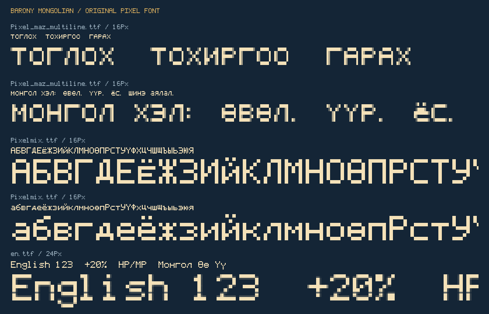

# Barony — Монгол орчуулга

Barony-г Steam-ээс ердийнхөөрөө нээхэд **шууд Монгол хэлээр** тоглох Windows багц.
Хэл сонгох цэс, мод ачаалах алхам шаардахгүй. Англи эх файлыг суулгагч нөөцөлнө;
uninstall хийхэд англи хувилбарыг буцаан сэргээнэ.

**Туршилтын, дутуу орчуулга:** 5,727 текстийн хэсэг Монгол болсон. Үндсэн цэс,
тохиргоо, эд зүйл/шившлэгийн нэрс, дүрийн ангилал/язгуурын тайлбар, төлөвийн нөлөө,
тулааны олон мэдэгдэл орсон. Ном, нэвтэрхий толь, дэлгэрэнгүй тайлбар болон
зарим сургалт, баярын текст англи хэвээр. Дуу оруулалт өөрчлөгдөхгүй.

Кирилл үсэг, **Ө ө Ү ү** болон латин үсгийг дөрвөлжин цэгээс зурсан pixel фонтоор
харуулна. Багцын фонтууд нь энэ төслийн шинээр зурсан үсгүүд бөгөөд Arial ашиглахгүй.



## Шаардлага

- Windows 10/11, Windows PowerShell 5.1 эсвэл PowerShell 7.
- Barony **v5.0.2.2026.04.03** дээрх файлуудад зориулсан. Бусад хувилбарын файл таарахгүй
  бол суулгагч дарж солихгүйгээр зогсоно.
- Python болон нэмэлт программ суулгах шаардлагагүй.
- Эхлээд тоглоомыг хаана. Steam хадгалалтууд болон `barony.exe`-г өөрчлөхгүй.

## Install — суулгах

1. Энэ сангийн **Code → Download ZIP**-ийг дарж татна.
2. ZIP дээр **Extract All / Бүгдийг задлах** сонгоно. ZIP дотроос нь шууд ажиллуулахгүй.
3. Задалсан хавтсыг нээгээд хаягийн мөрөнд `powershell` бичиж Enter дарна.
4. Дараах командыг ажиллуулна:

   ```powershell
   powershell.exe -NoProfile -ExecutionPolicy Bypass -File .\Install-Mongolian.ps1
   ```

5. `Mongolian installed` гэсэн амжилтын мэдэгдлийн дараа Steam дээр **Play** дарна.

Суулгагч Steam-ийн сангуудаас Barony-г хайна. Автоматаар олохгүй бол замаа заана:

```powershell
powershell.exe -NoProfile -ExecutionPolicy Bypass -File .\Install-Mongolian.ps1 -GamePath "D:\SteamLibrary\steamapps\common\Barony"
```

`Program Files` дотор бичих эрх хүрэхгүй гэсэн алдаа гарвал **Windows PowerShell →
Run as administrator** нээгээд `cd "задалсан хавтасны зам"` хийж командыг дахин ажиллуулна.
`ExecutionPolicy Bypass` нь зөвхөн энэ ажиллуулалтад үйлчилнэ.

## Uninstall — англи хэл рүү буцаах

Тоглоомыг хаагаад задласан багцын хавтаснаас:

```powershell
powershell.exe -NoProfile -ExecutionPolicy Bypass -File .\Uninstall-Mongolian.ps1
```

Эсвэл тодорхой замтай:

```powershell
powershell.exe -NoProfile -ExecutionPolicy Bypass -File .\Uninstall-Mongolian.ps1 -GamePath "D:\SteamLibrary\steamapps\common\Barony"
```

Суулгагчийн нөөцөөс англи файлуудыг сэргээнэ. Тоглоомын хавтас дахь
`.barony-mongolian-backup` нөөцийг uninstall хийсний дараа ч хадгална.
Энэ хавтсыг өөр компьютерийн нөөцөөр сольж болохгүй. Дахин Монгол болгохдоо install командыг ажиллуулна.

## Шинэчлэх, асуудал шийдэх

- **Орчуулгын шинэ хувилбар:** шинэ ZIP-ийг тусдаа хавтаст задлаад install командыг
  дахин ажиллуулна. Анхны англи нөөцийг Монгол файлаар дарж солихгүй.
- **Steam тоглоомыг шинэчлэхийн өмнө:** uninstall хийж англи хувилбарыг сэргээхийг зөвлөе.
  Шинэ Barony хувилбарт тохирох орчуулгын багц хэрэгтэй байж болно.
- **Файлын checksum таарахгүй:** өөр мод эсвэл шинэчлэлт файл өөрчилсөн байж болно.
  Суулгагч/устгагч тухайн файлыг дур мэдэн дарж бичихгүй. Нөөцөө хадгалж,
  Steam → Properties → Installed Files → Verify integrity ашиглан цэвэр англи файлуудыг сэргээж болно.
  Энэ нь бусад модын өөрчлөлтийг мөн буцааж болзошгүй.
- **Тоглоом нээлттэй:** тоглоомоо хаагаад командыг дахин ажиллуулна.
- **Зөвхөн татсан ZIP хавтсыг устгах** нь тоглоомоос орчуулгыг арилгахгүй;
  эхлээд uninstall командыг ажиллуулна.

## Орчуулгад хувь нэмэр оруулах

`manual_mn.json`, `manual/*.tsv`, `manual/classes.json` дотор орчуулгууд байрлана.
`*.ids.tsv` файлын эхний багана нь хэлний тоон ID; бусад TSV-ийн эхний багана нь англи эх.
Хоёр дахь багана нь Монгол орчуулга. `\n`, `%s`, `%d`, `%+2d` зэрэг удирдах тэмдэг,
орлуулгын параметрийн тоо, дарааллыг хадгална.

Хөгжүүлэгчийн build нь өөрийн суулгасан Barony-ийн англи эх файлыг ашиглана:

```powershell
python -m pip install -r requirements.txt
$env:BARONY_PATH = "D:\SteamLibrary\steamapps\common\Barony"
python -X utf8 localization.py snapshot
python -X utf8 build_mod.py
python -X utf8 validate_mod.py
python -X utf8 package_release.py
```

Snapshot авахдаа цэвэр англи тоглоом ашиглана. `source/`, англи нөөц, хадгалалт,
компьютерийн хувийн зам/суулгалтын бүртгэл GitHub-д орохгүй.
`package_release.py` нь `dist/` дотор суулгах ZIP болон SHA-256 файл үүсгэнэ.
End-user дээр build хийх шаардлагагүй; бэлэн `Barony-Mongolian/` багц сан дотор байгаа.

Техникийн шалгалт нь JSON бүтэц, хэлний ID, орлуулах параметр, тоглоомын 64 КБ radial
JSON хязгаар, pixel үсгийн хамрах хүрээ болон суулгах/устгах ажиллагааг шалгана.
Бүх тоглоомын дэлгэцийн байрлал, бүх англи үлдсэн текст бүрэн шалгагдсан гэсэн үг биш.

## Зохиогч, эх сурвалж

Barony болон тоглоомын эх агуулга нь Turning Wheel LLC болон холбогдох зохиогчдын бүтээл.
Энэ нь албан бус Монгол орчуулгын нэмэлт; тоглоомыг өөрийг нь агуулаагүй.
Шинээр зурсан pixel үсгийн эх код, суулгагч болон build хэрэгслүүдийн лицензийг
[LICENSE](LICENSE)-ээс үзнэ. Тоглоомын эх агуулгын эрх хэвээр хадгалагдана.
